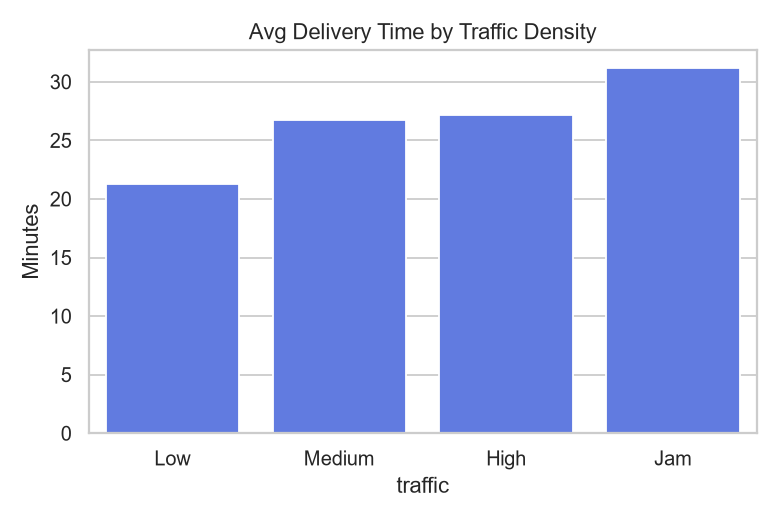
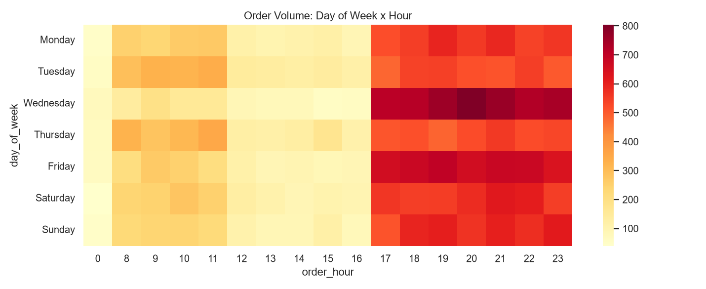

# food-delivery-analytics
# 🍔 Food Delivery & Restaurant Analytics

End-to-end analytics project on online food delivery: data cleaning, EDA, SQL analysis,
a delivery-time prediction model and an interactive Streamlit dashboard.

## Business Questions
1. What drives delivery time (distance, traffic, weather, festivals, multiple orders)?
2. When is demand highest (hour of day, day of week)?
3. Which vehicle types, cities and riders perform best?
4. Can we predict delivery time before dispatching the order?

## Dataset
[Food Delivery Dataset (Kaggle, Gaurav Malik)](https://www.kaggle.com/datasets/gauravmalik26/food-delivery-dataset): about 45,000 orders with
rider details, coordinates, weather, traffic, vehicle type and delivery time.
Download `train.csv` and place it in `data/raw/`.

## Tech Stack
Python (pandas, numpy, seaborn, plotly, scikit-learn), SQL (SQLite), Streamlit, Git/GitHub

## Project Structure
```
├── data/raw/            raw CSV (not committed)
├── data/processed/      cleaned data
├── src/                 clean_data.py, eda.py, sql_analysis.py, model.py
├── sql/                 analysis_queries.sql
├── app/dashboard.py     Streamlit dashboard
├── images/              charts and dashboard screenshots
└── reports/             insights.md, model_metrics.json
```

## How to Run
```bash
pip install -r requirements.txt
python src/clean_data.py
python src/eda.py
python src/sql_analysis.py
python src/model.py
streamlit run app/dashboard.py
```

## Key Insights
> Run `python src/eda.py`, then paste the content of `reports/insights.md` here.

## Model Results
> Paste `reports/model_metrics.json` here (MAE in minutes, R²).

## Screenshots




## Future Improvements
- Add a restaurant-level dataset (e.g. Zomato) to analyse cuisines, ratings and cost
- Deploy on Streamlit Community Cloud
- Try XGBoost / LightGBM and hyperparameter tuning